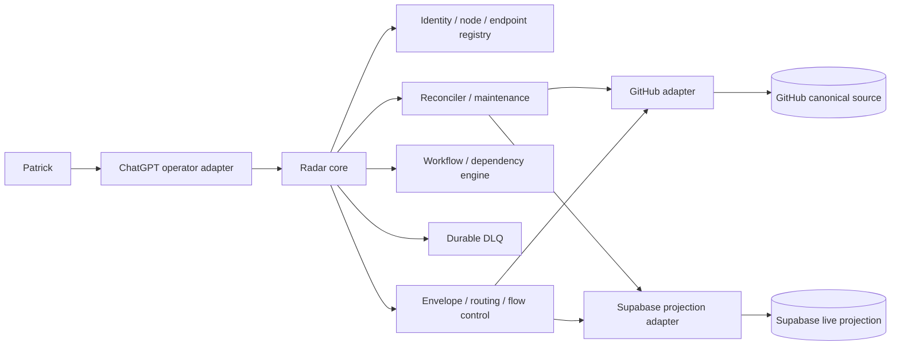
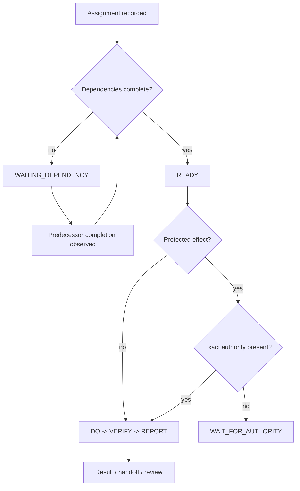
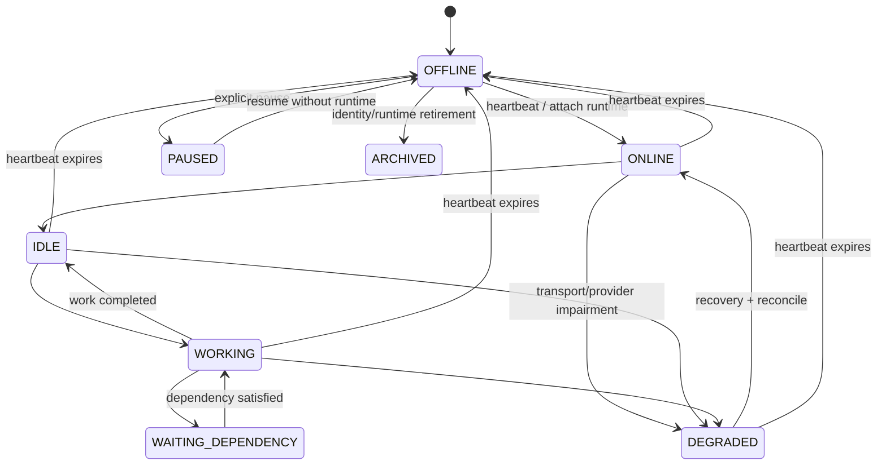
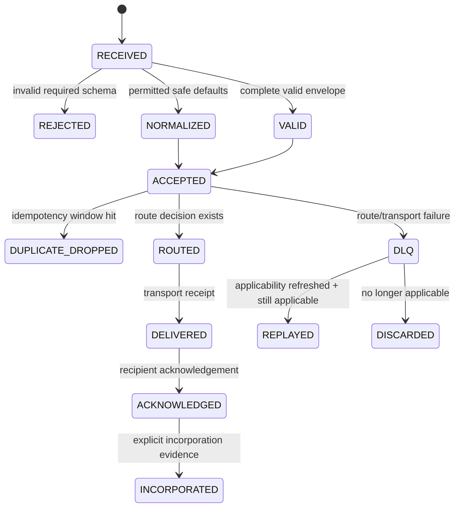
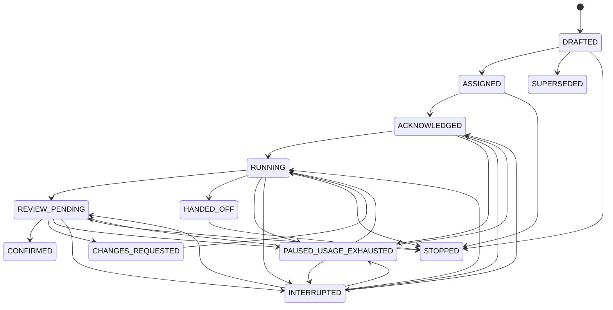
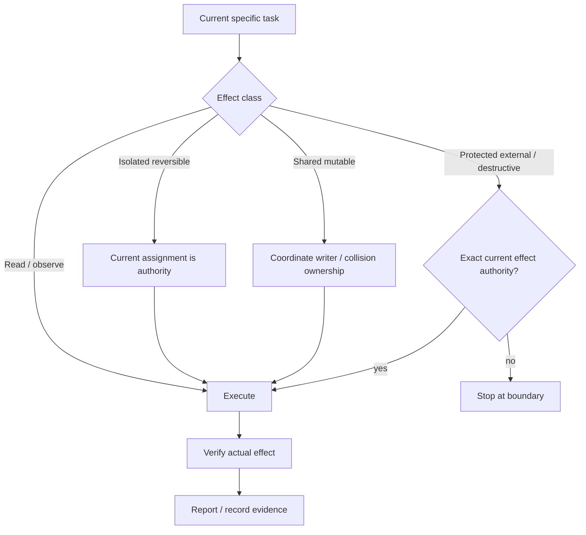
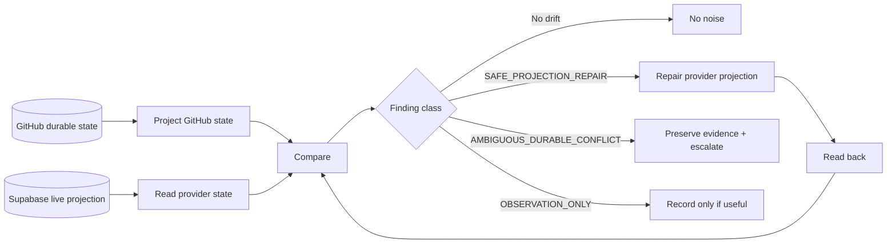

# Radar control-plane views

These views complement `system-context.md`, `message-flow.md`, and `recovery-flow.md`. They describe intended V1 architecture; observed runtime/provider state still requires fresh evidence.

## Component map

## Assignment / dependency flow

Readiness is scheduling state, not permission. Dependency completion never manufactures protected-effect authority.

## Node / presence lifecycle

Node state is runtime reachability. It does not create or destroy the logical identity.

## Message lifecycle

Delivery is deliberately separated from acknowledgement and incorporation.

## Assignment lifecycle

The legacy `chat_bus` ledger remains the database-enforced reference for detailed predecessor/transition invariants during V1 compatibility.

## Authority / effect boundary

Leases coordinate collision risk; they do not manufacture permission already supplied by a current specific task.

## GitHub / Supabase reconciliation loop

GitHub source/provenance is not overwritten to make a stale live projection look consistent. Provider loss is recoverable by replaying Git-held migrations/seed and reconciling current Git state.
