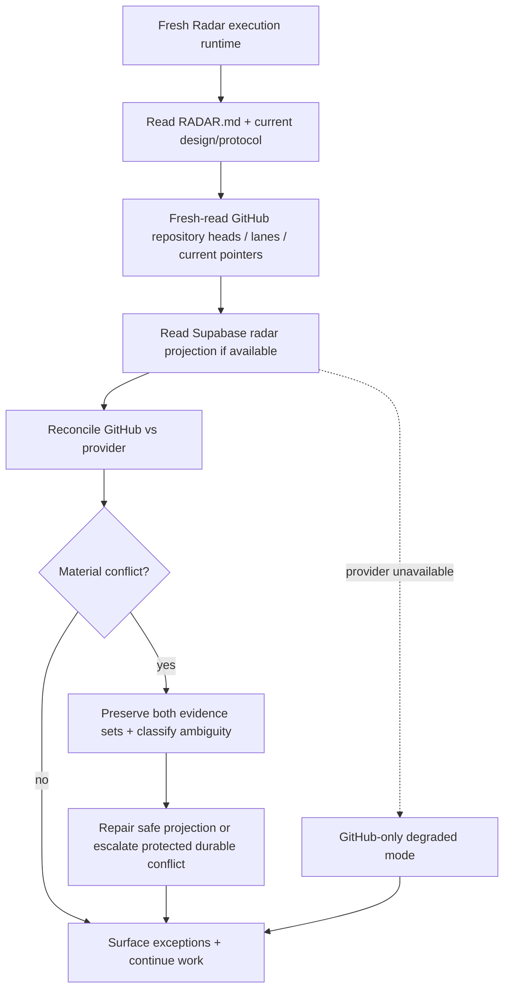

# Radar recovery / bootstrap flow

Recovery target: loss of any ChatGPT conversation, temporary execution runtime, or provider cache does not erase Radar's architecture, protocols, source, assignments, or durable repository provenance. A permanent Radar chat is not required.