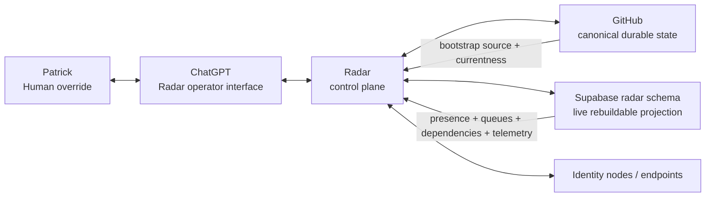

# Radar system context

Boundary rule: GitHub owns durable source/provenance; Supabase accelerates live coordination; ChatGPT supplies reasoning/operator interaction; no single ChatGPT session is required for Radar continuity.