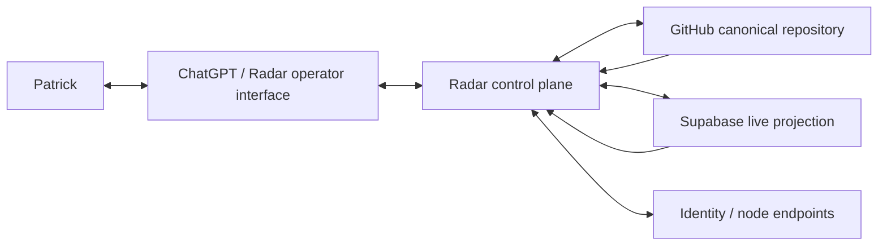

# Radar Control Plane Design

## Status

Approved architecture translated from Patrick's September 2, 2026 Radar design session. This document is the implementation contract for `radar/control-plane-v1`.

## Mission

Radar is the owner/operator control system for `thebrazenbeard/chat-communication-bus`. Patrick has override authority over Radar. Other identities may own delegated writer lanes and work, but neither Vera nor any coordinator outranks Radar for repository architecture, protocol, routing, maintenance, or evolution.

ChatGPT is the operator interface. GitHub is the durable canonical source/custody layer. Supabase is a rebuildable live projection, routing, presence, dependency, telemetry, and reconciliation substrate. Radar must remain recoverable when any one ChatGPT conversation disappears.

## Core invariants

1. Routing evidence is not authority evidence.
2. Presence is not identity existence.
3. Priority is not permission.
4. Delivery is not incorporation.
5. Assignment is not completion.
6. Supabase projection is not GitHub canonical history.
7. A missing object explicitly assigned to be created is an action trigger, not a blocker.
8. A current narrow reversible instruction is sufficient for its necessary reversible setup.
9. Protected effects remain separately gated; reversible isolated work defaults to DO -> VERIFY -> REPORT.
10. Radar must be reconstructable from durable GitHub state plus explicitly admitted provider receipts.

## Existing source disposition

- `feature/slack-identity-relay-v1@be93d0b7543e9e96c7f0f77a11c0aa8d29e56609`: implementation predecessor. Preserve ledger, digest, logical identity, relay idempotency, tests, and useful documentation.
- `feature/chat-bus-vertical-slice-v1`: historical branch. Its post-base commits only add and remove `__invalid__`; no unique implementation state remains after the common ledger commit.
- `bus/protocol-v2@884dbf7b2aeafe56d153b6553257b49b125f562b`: current coordination semantics to graduate into canonical protocol documentation.
- `main`: historical stub until verified cutover.
- Writer-owned `bus/*` branches: durable mailboxes/provenance. Do not rewrite ordinary message history.

## System context



## Components

### Identity Registry
Separates stable logical identity, ephemeral node/session, and transport endpoint. Aliases must be deterministic and collision-rejected. Identity existence survives node offline state.

### Message Envelope
Versioned transport-neutral envelope with message ID, sender, audience, domain, intent, priority, correlation/root/causal IDs, acknowledgment requirement, TTL, authority/source references, content hash, idempotency key, and payload. Validation classifies VALID, NORMALIZED, REJECTED, or DLQ.

### Router
Supports direct addressing and subscription routing. Priority affects queue order only. Router never converts priority or routing state into authority.

### Workflow / Dependency Engine
Preserves immutable assignment identity, legal lifecycle transitions, predecessor-bound supersession, pause/interruption context, acceptance receipts, and explicit dependency edges. Dependency satisfaction changes readiness; it does not grant protected-effect authority.

### Presence / Health
Tracks nodes and endpoints separately from identities. Expected states include ONLINE, IDLE, WORKING, WAITING_DEPENDENCY, DEGRADED, OFFLINE, PAUSED, ARCHIVED. Heartbeat expiry changes node liveness only.

### Durable DLQ
Stores failed envelope, failure stage/code, route attempted, retry count, current applicability, replay state, and diagnostics. Replay means refresh -> determine still applicable -> safely retry, not blind resend.

### Reconciler
Compares GitHub durable state with Supabase projection and emits findings such as missing lanes, projection drift, stale heads, duplicate ownership, newly satisfied dependencies, and stale acknowledgments. Safe projection repairs may be automated; ambiguous durable-state conflicts escalate.

### GitHub Adapter
Understands repository branches, writer lanes, protocol heads, messages, commits, issues, PRs, source hashes, currentness, and supersession. GitHub alone must be sufficient to rebuild core Radar state.

### Supabase Adapter
Maintains a live `radar` namespace for identities, nodes, endpoints, subscriptions, messages, delivery events, acknowledgments, dead letters, assignments, assignment events, dependencies, health, reconciliation events, and telemetry. Migration source lives in Git before provider application.

### Operator Interface
Defines repeatable Radar operations: STATUS, RECONCILE, ROUTES, IDENTITIES, DEPENDENCIES, DLQ, HEALTH, AUDIT. ChatGPT performs reasoning and orchestration; durable state does not live only in the chat transcript.

## Supabase decision

V1 uses an isolated `radar` schema in the existing healthy Vera Supabase project unless provider constraints make that impossible. Reasons: no extra project cost, close ecosystem observation, simpler cross-system reconciliation, and adequate isolation through schema ownership/grants/RLS. Radar data remains semantically distinct from Vera memory or identity state.

Supabase is a projection/coordination provider, not Radar's sole source of truth. Provider application requires exact migration source custody and readback.

## Data flow

### Message
sender -> validate envelope -> classify -> resolve direct/subscription routes -> enqueue by priority -> record delivery attempt -> deliver -> acknowledge/readback -> durable projection/reconciliation.

### Dependency
assignment event -> dependency edge projection -> predecessor completion/supersession -> readiness recalculation -> surface READY event -> worker continues under existing task authority.

### Recovery
fresh Radar session -> read current Radar contract -> inspect GitHub current heads -> inspect Supabase current projection -> reconcile -> surface exceptions -> continue work.

## Failure handling

- One transient safe read failure: retry once, then use an independent read path when available.
- Non-idempotent write failure: inspect whether the effect committed before retry.
- Deterministic validation/auth/integrity failure: do not retry as transient.
- Realtime loss: reconnect and reconcile from durable tables/GitHub.
- Supabase loss: operate degraded from GitHub and rebuild projection.
- ChatGPT session loss: bootstrap from repository/operator contract and current provider projection.

## Repository target structure

```text
README.md
RADAR.md
architecture/
  decisions/
  diagrams/
  contracts/
docs/
  operator/
  protocol/
  superpowers/specs/
  superpowers/plans/
schemas/
src/radar/
supabase/migrations/
supabase/tests/
tests/radar/
scripts/
```

Existing `src/chat_bus` remains as a compatibility package during V1 migration; Radar-native code lives under `src/radar` and may wrap proven legacy primitives rather than rewrite them without reason.

## Security / authority model

Patrick > Radar for this repository. Radar owns repository architecture and may delegate writer-owned lanes. Repository ownership does not automatically grant Radar production authority outside the repository. Provider-side Radar effects are limited to the explicitly assigned Radar/Supabase build scope and must be source-bound and verified.

Secrets never enter Git. Service-role credentials never enter client code. Exposed schemas/tables require deliberate grants and RLS. Security-definer functions, if needed, live in non-exposed schemas with fixed search paths.

## Test strategy

- Unit: envelope, identity, routing, dependency, dedupe, priority, TTL.
- Legacy regression: existing ledger/digest/identity/relay tests.
- Protocol regression: missing instructed lane => ACTION_REQUIRED/CREATE; newer isolated-branch authority overrides stale LOCAL_ONLY only within scope; no redundant permission loop.
- Database: migration shape, constraints, RLS/grants, append-only event behavior, dependency readiness, DLQ persistence.
- Integration: GitHub branch/lane projection, Supabase reconciliation, recovery bootstrap.
- CI: compile + full pytest on every PR and Radar integration branch push.

## Acceptance for Phase 18

Ready for Phase 19 when:

- Radar identity/authority contract exists.
- Repository inventory/disposition is recorded.
- Architectural diagrams and ADRs exist.
- Canonical Radar package implements envelope, identity/node model, routing, workflow/dependencies, DLQ, reconciliation, and operator projections.
- Supabase migration and database tests exist and are source-bound; provider state is applied/read back if authorization/capability permits.
- CI is current and green for the integration branch.
- GitHub/Supabase reconciliation has an executable path.
- Radar is represented as a managed identity.
- Maintenance/audit scripts and recovery/bootstrap documentation exist.
- Historical feature/protocol branches have explicit disposition; no history rewrite is required.
